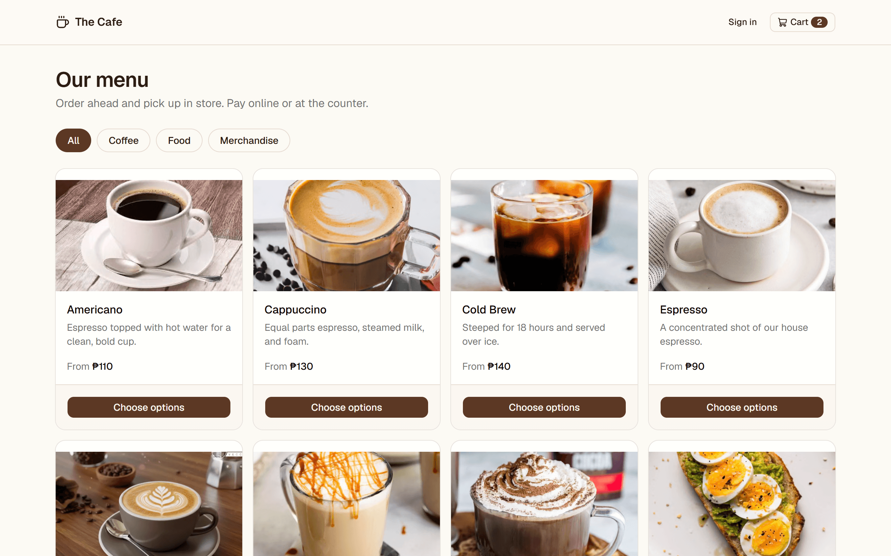
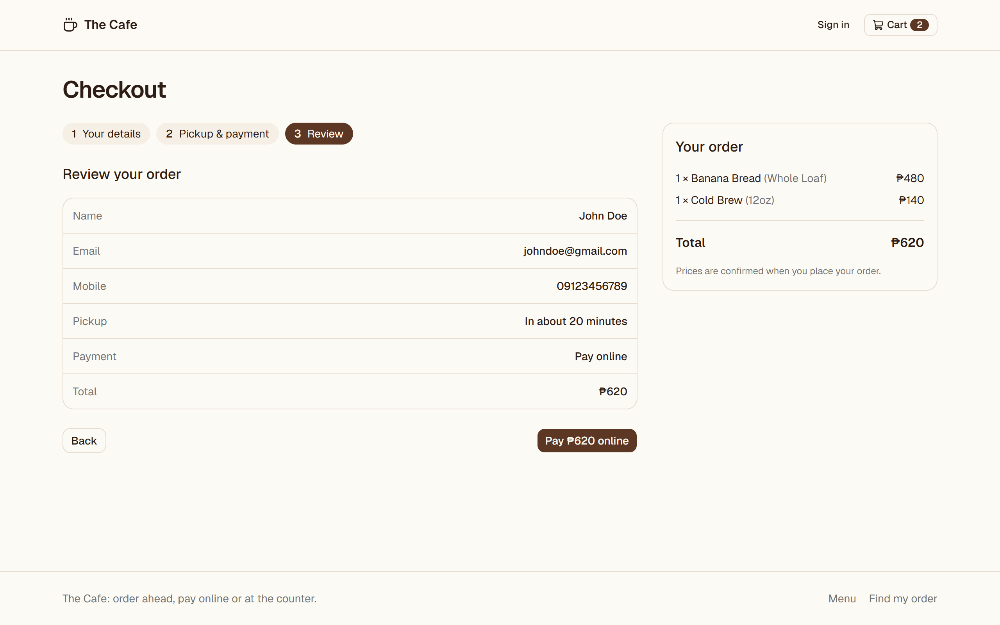
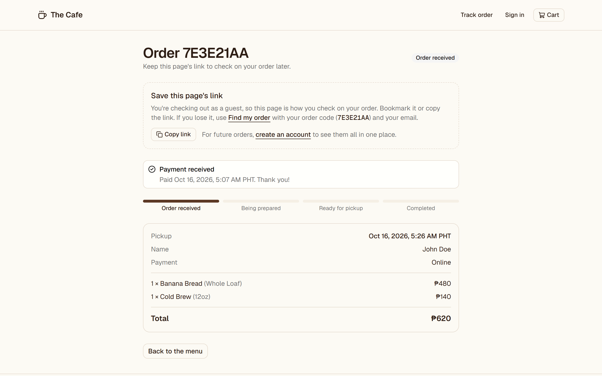
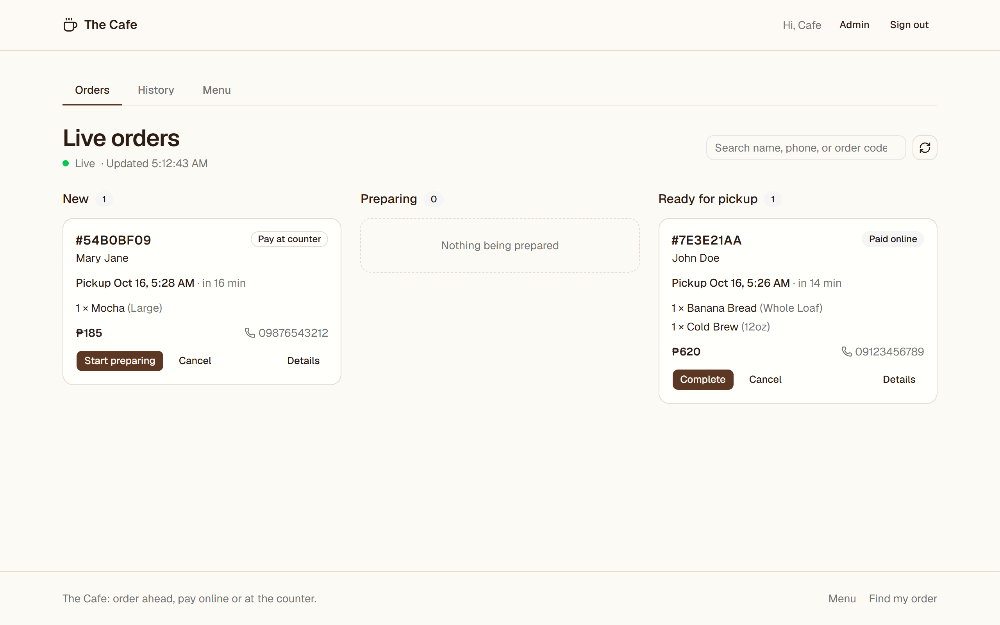
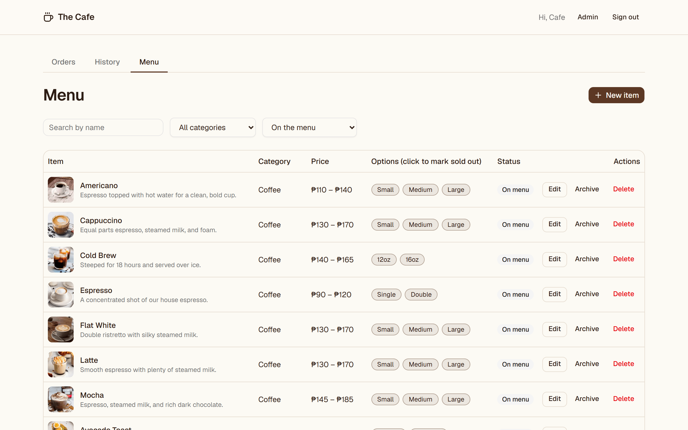
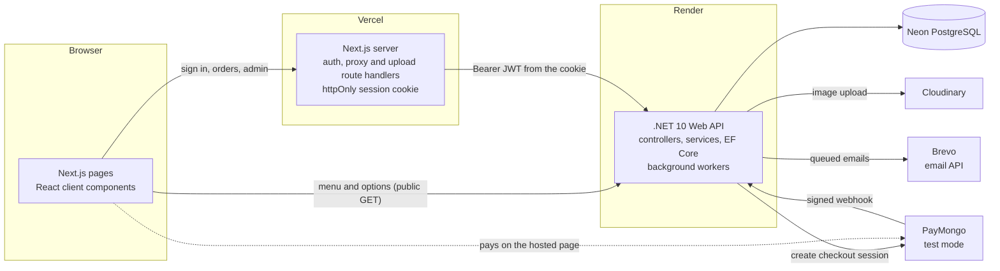

# The Cafe: order-ahead e-commerce for a local boutique cafe

[](https://github.com/EnterCapslock/cafe-commerce/actions/workflows/ci.yml)


Customers browse the menu, order ahead, and pay online (GCash, Maya, GrabPay, QR Ph, or card) or at the counter, then get
an email confirmation and a second one when their order is ready. Baristas run the shop from a live order board.
Built as a production-style full-stack project: a Next.js frontend, a .NET Web API, PostgreSQL, a real payment gateway,
transactional email, and a test suite that runs on every push.

**Live demo:** <https://cafe-commerce.vercel.app/>
*(The API runs on a free tier that sleeps when idle, so the first visit can take up to a minute to wake it. After that it's fast.)*

| Menu | Checkout | Order tracking |
|---|---|---|
|  |  |  |

| Live order board | Menu management |
|---|---|
|  |  |

## Features

**Customers**
- Menu with categories, product photos, and size/option variants, with prices in Philippine pesos
- Cart that survives a refresh, with a warning if an item was removed or repriced since it was added
- Three-step checkout with a pickup-time picker in Philippine time
- **Pay online** through PayMongo's hosted checkout (test mode), or **pay at the counter** for orders up to ₱1,000
- Order tracking page that updates on its own, with a "Pay now" button to resume an unfinished payment
- **Email confirmation** when an order is placed or paid, and an email when it's **ready for pickup**
- Guest checkout, or an account with order history and prefilled details
- **Find my order:** guests who lose their link can recover it with the order code and their email

**Staff**
- Role-based admin area (the API enforces roles; the UI only reflects them)
- Live order board: new orders appear within seconds, one-click status changes, cancel with confirmation, search, and history
- Menu management: create and edit items with a variants editor, mark an option sold out in one click, archive or delete, upload photos
- Admin accounts cannot place orders (separation of duties, enforced by the API)

**Platform**
- The server prices every order and snapshots names and prices, so history survives menu edits
- Signed, idempotent payment webhook; status changes follow an enforced state machine
- Transactional email outbox: emails are saved with the change that caused them and sent by a background worker with retries
- Per-visitor rate limiting, RFC 7807 error responses, and health checks

## Architecture



The browser never sees the JWT: the Next.js server keeps it in an `httpOnly` cookie and attaches it when it forwards
requests to the API. More diagrams (the payment flow, the email outbox, and the database schema) are in
[docs/architecture.md](docs/architecture.md).

## Tech stack

| Area | Technology |
|---|---|
| Frontend | Next.js 16 (App Router), React 19, TypeScript (strict), Tailwind CSS 4, shadcn/ui, Zustand, React Hook Form, Zod |
| Backend | .NET 10 Web API, EF Core 10 with Npgsql, FluentValidation, JWT bearer auth, BCrypt |
| Database | PostgreSQL 16 (Neon in production) |
| Payments | PayMongo hosted checkout and webhooks (test mode) |
| Email | Brevo HTTP API, sent through a database outbox |
| Images | Cloudinary (validated on upload, resized in the URL) |
| Testing | xUnit, Testcontainers and `WebApplicationFactory`, Playwright |
| CI/CD | GitHub Actions, Dependabot; deployed on Vercel, Render (Docker), and Neon |

## Quality

- **285 backend tests.** Unit tests cover pure logic (validation, payment signatures and amounts, token handling,
  image checks, the order state machine, email composition and delivery rules). Integration tests start the real API
  against a **real PostgreSQL container**, with fakes only at the edges (clock, payment network, image storage, email
  provider). They cover auth and roles, server-side pricing, privacy of orders, admin rules, the **payment webhook**
  (valid, duplicate, forged, mismatched), the cleanup job, guest order lookup, and the **email outbox** (queueing,
  retries, permanent failures, and retention).
- **20 end-to-end tests** (Playwright) drive the real UI in a browser: the shopping flow, checkout rules, accounts,
  guest order recovery, the barista board with two browsers at once, menu management, and the access rules.
- **CI** builds and runs all of it on every push and pull request.
- Strict TypeScript with no `any`, lint on every change, and conventional commit messages.

## Project structure

```
backend/
  src/Cafe.Api/
    Controllers/      HTTP entry points (Admin/ for staff endpoints)
    Services/         business logic by feature: Auth, Catalog, Orders, Admin, Notifications (+ Interfaces/)
    Infrastructure/   adapters for outside systems: Payments (PayMongo), Images (Cloudinary), Mail (Brevo)
    Data/             DbContext, entity configuration, migrations, seeding
    Models/           Entities, DTOs, Enums
    Validators/       FluentValidation rules
    Middleware/, Extensions/
  tests/Cafe.Api.Tests/   Unit/ and Integration/
frontend/
  src/app/            routes, including the Next.js route handlers (auth, proxy, upload)
  src/components/     by feature: admin, auth, cart, checkout, menu, orders, layout, shared, ui
  src/lib/            api/ client, hooks/, schemas/, server/ helpers, small utilities
  src/stores/         cart store
  e2e/                Playwright tests
docs/                 architecture, decisions, configuration, API reference
```

## Run it locally

You need the **.NET 10 SDK**, **Node.js 22**, and **Docker** (for PostgreSQL and the tests).

```bash
# 1. Database
docker compose up -d db            # PostgreSQL on localhost:5433

# 2. API (secrets stay out of git, in .NET user-secrets)
cd backend/src/Cafe.Api
dotnet user-secrets init
dotnet user-secrets set "ConnectionStrings:Default" "Host=localhost;Port=5433;Database=cafe;Username=postgres;Password=postgres"
dotnet user-secrets set "Jwt:Key" "$(openssl rand -base64 48)"
dotnet user-secrets set "Jwt:Issuer" "cafe-api"
dotnet user-secrets set "Jwt:Audience" "cafe-web"
dotnet user-secrets set "Seed:AdminEmail" "admin@cafe.local"
dotnet user-secrets set "Seed:AdminPassword" "choose-a-strong-password"
dotnet run                          # http://localhost:5080, migrates and seeds a 15-item peso menu

# 3. Web app (in a second terminal)
cd frontend
npm install
cp .env.example .env.local          # NEXT_PUBLIC_API_URL=http://localhost:5080
npm run dev                         # http://localhost:3000
```

Sign in at `/login` with the seeded admin to see the order board and menu management.
Interactive API docs (development only) are at `http://localhost:5080/scalar/v1`.

**Optional integrations.** Everything works without these, and each one switches a feature on:

- **Online payments:** add a PayMongo **test** secret key (`dotnet user-secrets set "PayMongo:SecretKey" "sk_test_..."`),
  expose the API with a tunnel such as `cloudflared tunnel --url http://localhost:5080`, register
  `https://<tunnel>/api/payments/webhook` for the `checkout_session.payment.paid` event in PayMongo's dashboard (test mode),
  and store its secret as `PayMongo:WebhookSecret`. Pay-at-counter needs none of this.
- **Photo uploads:** `Cloudinary:CloudName`, `Cloudinary:ApiKey`, and `Cloudinary:ApiSecret`.
- **Emails:** `Email:BrevoApiKey` and `Email:FromAddress` (an address verified in Brevo). Without them, emails are written to
  the API log instead of being sent.

## Run the tests

```bash
cd backend && dotnet test                                  # unit and integration (needs Docker running)

cd frontend
npm run lint && npx tsc --noEmit                           # lint and type check
npm run e2e                                                # Playwright: starts its own API, web app, and database
```

The end-to-end suite runs on separate ports (API 5180, web 3100) and its own `cafe_e2e` database, so it never touches your
development data. `npm run e2e:reset` wipes that database.

## Deployment

The web app runs on **Vercel**, the API on **Render** (from the Dockerfile in `backend/src/Cafe.Api`), and the database on
**Neon**. Migrations run on start-up in production. Every setting and the step-by-step setup are in
[docs/configuration.md](docs/configuration.md).

## Try the live demo

1. Open the site, add a **Flat White (Large)** and a pastry, and check out. Use an email address you can read: the
   confirmation really is sent (check spam the first time).
2. Choose **Pay online**. On PayMongo's test page pay with a test card or e-wallet (see
   [PayMongo's testing guide](https://developers.paymongo.com/docs/payment-acceptance-testing)); no real money moves.
   You land back on your order page, which flips to **Paid** by itself once the signed webhook arrives.
3. Close the order page, then use **Find my order** in the footer with your order code and email to get back to it.
4. Register an account to see **My orders**, prefilled checkout, and the "unpaid order" reminder.
5. The staff side (live board, menu editor) needs an admin account. Credentials are not published because the demo is
   public, so please [contact me](#contact) for access or see the screenshots above.

## Design decisions worth a look

The full list, with trade-offs, is in [docs/decisions.md](docs/decisions.md). Highlights:

- **The server decides the price.** The client sends variant ids and quantities only. Totals are computed from the database and snapshotted on the order.
- **Payments trust only signed webhooks.** The handler is idempotent and checks that the event matches the order's own checkout session.
- **Orders move through an enforced state machine.** Updates are conditional on the status the barista saw, so two baristas can't both win.
- **Cookie sessions through a backend-for-frontend.** The JWT lives in an `httpOnly` cookie, so page scripts can't read it.
- **Emails use a transactional outbox.** A provider outage or a sleeping server can't lose an email or block an order.
- **Tests that match production.** Integration tests use real PostgreSQL, not an in-memory fake.

## Known limits and roadmap

- **Cold starts.** Free tiers sleep when idle (Render after 15 minutes, Neon after 5), so the first request after a quiet period is slow.
- **Test-mode payments only.** Going live needs PayMongo business verification and refund handling (cancelled paid orders are flagged for a manual refund today).
- **Email on a free plan.** Brevo's free tier has a daily sending cap, and a brand-new sender (especially a Gmail address) can land in spam. A custom domain with DKIM would fix deliverability. There is no email yet for cancellations or refunds.
- **Stateless logout.** Signing out clears the cookie, but the token stays valid until it expires (60 minutes). Refresh tokens or a denylist would fix this.
- **Polling, not push.** The live board refreshes every 10 seconds. SignalR would make it instant.
- **Ideas for next:** add-ons and modifiers (oat milk, extra shot), opening hours and holidays, server-side carts, observability (OpenTelemetry), and refunds through the payment API.

## Contact

Michael Saymo · michaeldaluzsaymo@gmail.com · [LinkedIn](https://www.linkedin.com/in/michael-saymo-emaykeyie/)

## License

[MIT](LICENSE)