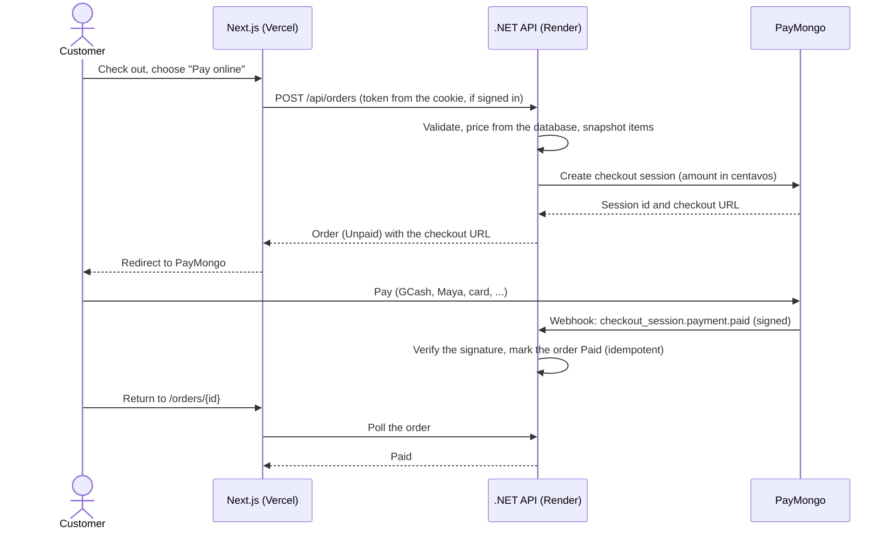
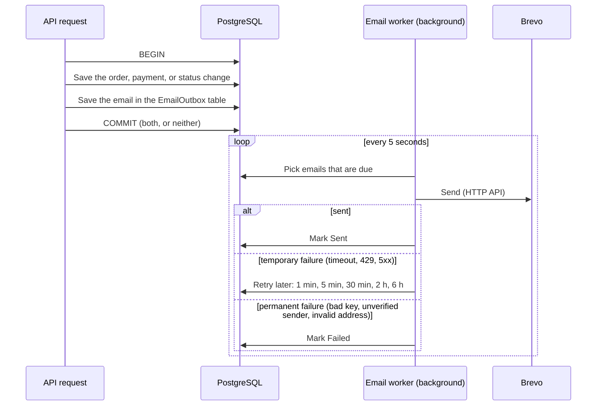
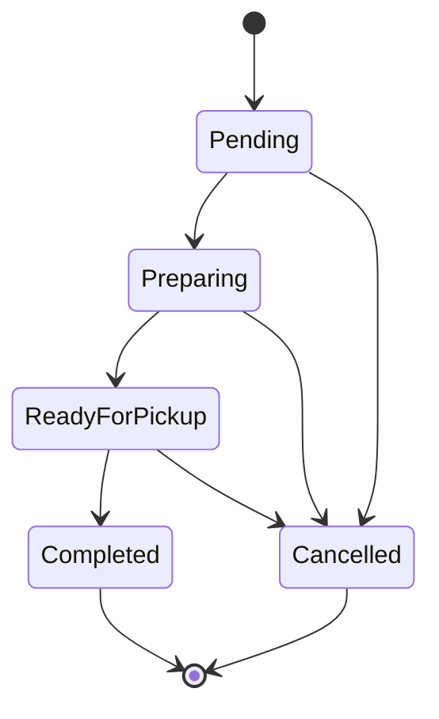
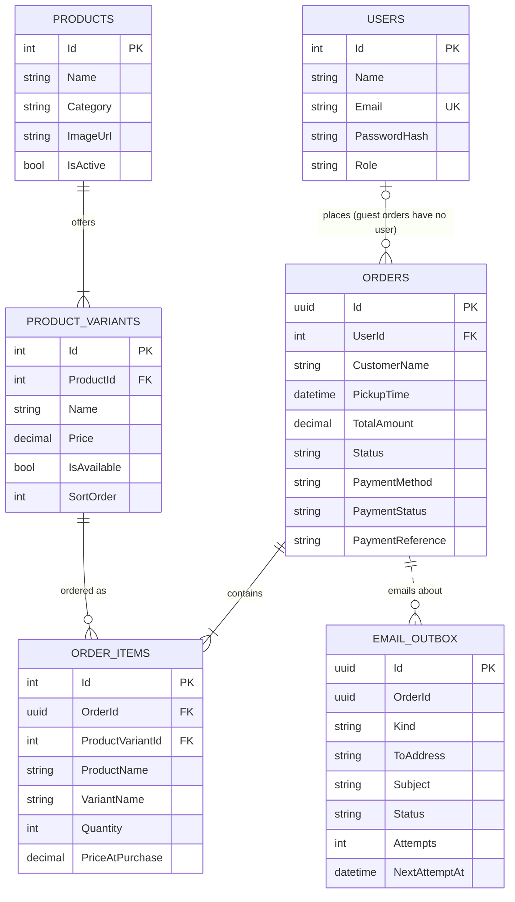

# Architecture

## System overview

See the diagram in the [README](../README.md#architecture). In short: public reads (the menu and product options) go from
the browser straight to the API. Everything that needs a session (sign-in, ordering, the admin area) goes through the
Next.js server, which holds the JWT in an `httpOnly` cookie and forwards requests to the API with it. The API owns all
business rules and talks to PostgreSQL, PayMongo, Cloudinary, and Brevo.

## Placing and paying for an online order

If PayMongo is unreachable when the order is placed, nothing is saved and the customer is told to try again (or pay at the
counter, when the order qualifies). A background job expires unpaid online orders after 30 minutes.

## Order emails: the transactional outbox

Emails: *order received* (counter orders when placed, online orders when the payment is confirmed) and *ready for pickup*.
An order paid after it was cancelled is not confirmed by email, because it needs a refund instead. Sent and failed rows are
deleted after 30 days.

## Finding a guest order

A guest who lost the link enters the 8-character order code (the start of the order id) and the email used at checkout.
Only guest orders can be found this way, and every kind of miss returns the same answer, so the endpoint never reveals
which orders exist. Attempts are limited per visitor (10 a minute) and per target email (10 an hour).

## Order status

Only these moves are allowed, and the server enforces them. Online orders can't advance until they're paid. Completing a
pay-at-counter order marks it paid, because the money was collected then.

## Database schema

Notes: money is `numeric(10,2)` in pesos; enums are stored as strings; timestamps are UTC. Order items copy the product and
option names and the price at purchase, so history stays correct after the menu changes. Items with past orders can't be
deleted, only archived. The outbox deliberately has no foreign key to orders, so its rows can outlive an order.